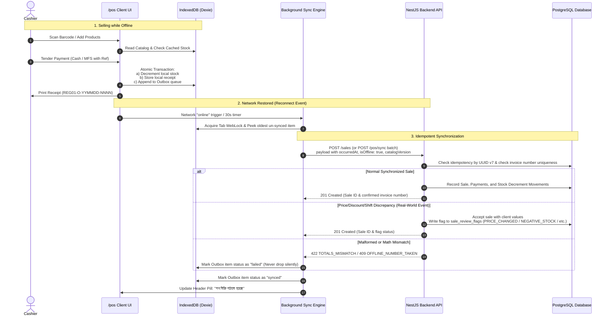

# Offline Mode Architecture & Sync Specification

## Overview

The Bangladesh Universal POS Management System provides resilient offline selling capabilities for `/pos`. Internet and power disruptions are frequent across retail environments in Bangladesh. Under offline conditions, cashiers must continue scanning, adding to cart, tendering cash or digital wallet payments, and printing thermal receipts without interruption or latency.

Every sale conducted offline must reach the server reliably, exactly once, with correct financial ledger balances, inventory movements, and shift records.

---

## 1. Scope: Offline vs. Online Capabilities

| Capability | Offline Status | Operational Behavior |
|---|---|---|
| **Product Search & Barcode Scan** | **Supported** | Queries local Dexie IndexedDB catalog; instant response time. |
| **Size / Colour Variant Matrix** | **Supported** | Evaluates locally stored variant attributes and prices. |
| **Cart Operations & Discounts** | **Supported** | Line item and bill discounts up to the cashier's cached discount limit. |
| **Hold & Recall Carts** | **Supported** | Persisted in local IndexedDB outbox/cart store. |
| **Cash Payment & Tender** | **Supported** | Exact change calculation; increments local cash drawer tracker. |
| **MFS / Card Payment (Offline)**| **Supported** | bKash, Nagad, Rocket, or Card recorded with mandatory transaction reference number (no live network verification). |
| **Customer Lookup & Create** | **Supported** | Lookup cached customers (up to 5,000); create new walk-in customer with client-side UUID v7 synced before the sale. |
| **Thermal Receipt Printing** | **Supported** | Prints 80mm or 58mm roll with offline indicator and unique offline invoice number (`REG01-O-YYMMDD-NNNN`). |
| **Cash In / Cash Out** | **Supported** | Records cash drawer movements into local shift store, syncs on reconnect. |
| **Shift Open & Close** | **Online Only** | Shift opening requires initial server verification; shift closing requires all sales and movements to be synced. |
| **Customer Credit Sales ("Baki")**| **Online Only** | Credit limit and live ledger balance cannot be guaranteed offline; blocked with explanatory tooltip. |
| **Returns & Exchanges** | **Online Only** | Requires server-verified original invoice and current drawer cash verification. |
| **Due Collection** | **Online Only** | Updating customer outstanding credit ledger requires live backend synchronization. |
| **Back Office (`(admin)` routes)**| **Online Only** | Shows blocking offline screen ("ইন্টারনেট সংযোগ নেই") with one-click link to `/pos`. |

---

## 2. Sync Architecture & Lifecycle



---

## 3. Data Structures & Offline Invoice Numbering

### Offline Invoice Number Format
- Structure: `{RegisterCode}-O-{YYMMDD}-{NNNN}`
  - Example: `REG01-O-261118-0001`
  - `REG01`: Code of the assigned physical register.
  - `-O-`: Explicit offline indicator distinguishing from standard online invoices.
  - `YYMMDD`: Date according to the tenant's operational timezone (`Asia/Dhaka`).
  - `NNNN`: Zero-padded 4-digit sequential counter stored in IndexedDB per register and business day.
- Single Tab Concurrency Guard: Enforced via the browser **Web Locks API** (`navigator.locks.request("pos_register_REG01")`), with `BroadcastChannel` fallback. Secondary tabs are rendered read-only to prevent duplicate invoice counter generation.

### Database Additions
- **`sales` table columns:**
  - `occurred_at`: DateTime (timestamp when the physical transaction took place). Reports and shift calculations use `occurred_at` instead of `created_at`.
  - `synced_at`: DateTime (timestamp when the sale was synced to the server; null for direct online sales).
  - `is_offline`: Boolean (true for sales originating offline).
  - `catalog_version`: String (version cursor of the catalog cached on client during sale).
- **`registers` table columns:**
  - `allow_offline`: Boolean (default true). Controls whether a register permits offline sales.
- **`users` table columns:**
  - `pos_pin_hash`: String (bcrypt/argon2 hash of the 4-6 digit POS unlock PIN).
- **`sale_review_flags` table:**
  - `id`: UUID (v7) Primary Key
  - `tenant_id`: UUID Foreign Key (RLS enabled)
  - `sale_id`: UUID Foreign Key -> `sales(id)`
  - `flag`: Enum string (`PRICE_CHANGED`, `PRICE_UNKNOWN`, `DISCOUNT_OVER_LIMIT`, `NEGATIVE_STOCK`, `PERMISSION_CHANGED`, `SHIFT_CLOSED`)
  - `details`: JSON payload containing snapshot deltas
  - `status`: String (`open`, `resolved`)
  - `resolved_at`: DateTime nullable
  - `resolved_by_user_id`: UUID nullable
  - `resolution_notes`: String nullable

---

## 4. Server Acceptance Rules at Sync

Since an offline transaction has already physically occurred and the customer has departed with the merchandise, the server never rejects a sale for non-critical business reasons:
1. **Price Changed / Deactivated:** Client price accepted; flagged as `PRICE_CHANGED` (or `PRICE_UNKNOWN` if client `catalogVersion` is unrecognised).
2. **Discount Exceeds Role Limit:** Client sale accepted; flagged as `DISCOUNT_OVER_LIMIT`.
3. **Negative Stock Created:** Stock decremented below zero; inventory ledger movement recorded; flagged as `NEGATIVE_STOCK`.
4. **Cashier Inactivated / Role Revoked:** Accepted; flagged as `PERMISSION_CHANGED`.
5. **Shift Closed on Server:** Accepted into shift; shift summary adjusted with audit trail; flagged as `SHIFT_CLOSED`.
6. **Integrity / Math Failure (`TOTALS_MISMATCH`):** Rejected with 422. Held in client outbox marked as `failed` for review.
7. **Duplicate Offline Number (`OFFLINE_NUMBER_TAKEN`):** Rejected with 409. Held in client outbox for operator intervention.

---

## 5. Running the Application by Hand on the Development Database

To run and test the complete application locally using the development database (`universal_pos`):

1. **Ensure PostgreSQL & Redis containers are running:**
   ```bash
   npm run docker:up
   ```

2. **Ensure development database is migrated and seeded:**
   ```bash
   # For a fresh reset of universal_pos (requires explicit --yes confirmation):
   npm run db:reset:dev -- --yes

   # Or seed demo data into universal_pos directly:
   npm run seed:demo
   ```

3. **Start the API Server in development mode:**
   ```bash
   npm --workspace=@universal-pos/api run start:dev
   ```
   *Note:* `npm run start:dev` runs `node scripts/dev.mjs`, which runs the TypeScript compiler in watch mode (`tsc --watch`) with full `emitDecoratorMetadata` preserved, coupled with Node `--watch` on `dist/main.js`. This guarantees that NestJS dependency injection works properly on all routes (including authentication).
   Alternatively, build and start directly:
   ```bash
   npm --workspace=@universal-pos/api run build && node apps/api/dist/main.js
   ```
   The API runs at `http://localhost:4000/api/v1`.

4. **Start the Admin & POS Front-end:**
   ```bash
   npm --workspace=@universal-pos/admin run build
   npm --workspace=@universal-pos/admin run start
   # Or run next dev:
   npm --workspace=@universal-pos/admin run dev
   ```
   The web application runs at `http://localhost:3000`.

5. **Log in to the POS:**
   - Navigate to `http://localhost:3000/login`.
   - Tenant Slug: `artisan-apparel`
   - Cashier Account:
     - Email: `cashier@artisan.com`
     - Password: `Password123!`
     - Redirects automatically to `/pos` with default register and open shift controls.
   - Owner Account:
     - Email: `owner@artisan.com`
     - Password: `Password123!`
     - Accesses `/dashboard`, settings, inventory, and back-office management.
